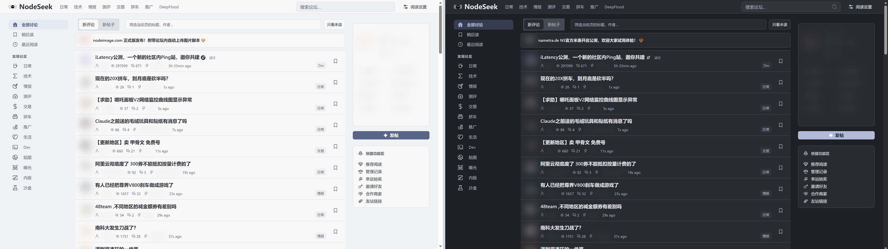
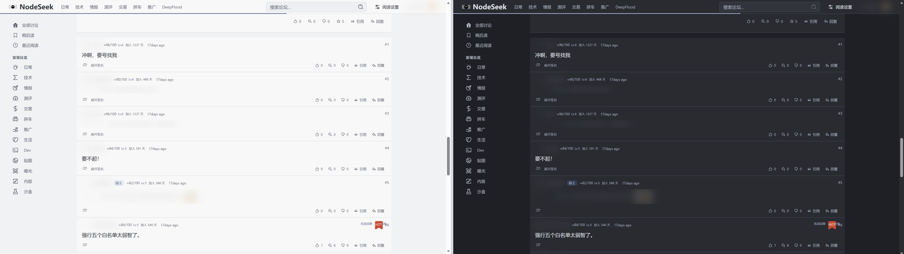
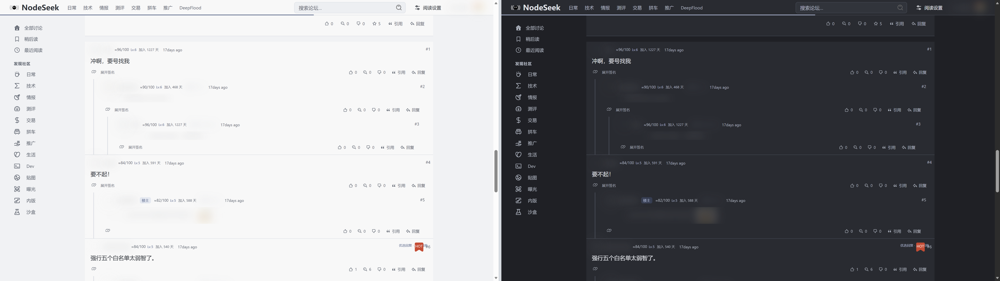
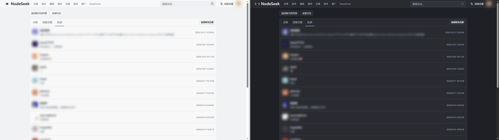

# SeekFlow

NodeSeek 阅读增强：连续评论、嵌套回复、浮动编辑器、五套明暗配色。

**[下载](https://github.com/TipsY14/SeekFlow/releases/latest)** · [扩展](https://github.com/TipsY14/SeekFlow/releases/download/v1.0.0/SeekFlow-1.0.0.zip) · [油猴](https://github.com/TipsY14/SeekFlow/releases/download/v1.0.0/SeekFlow-1.0.0.user.js) · [Stylus](https://github.com/TipsY14/SeekFlow/releases/download/v1.0.0/SeekFlow-1.0.0.user.css) · [CSS](https://github.com/TipsY14/SeekFlow/releases/download/v1.0.0/SeekFlow-1.0.0.css)

### 首页

### 按时间评论

### 嵌套评论

### 消息

[Apache-2.0](LICENSE) · [NOTICE](NOTICE)
